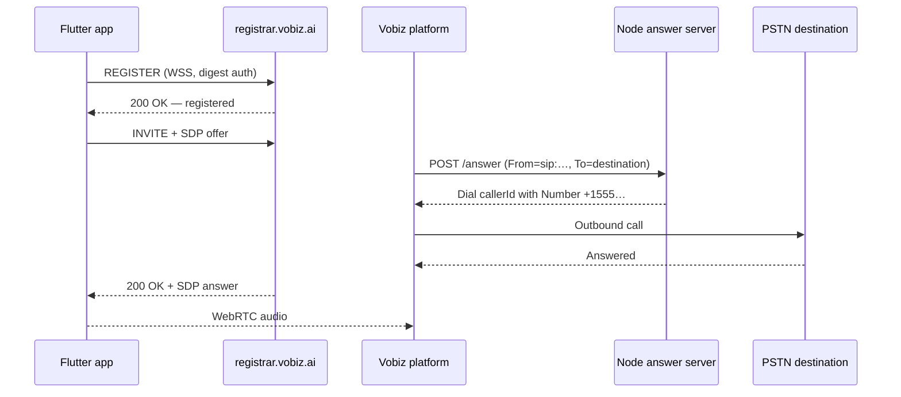
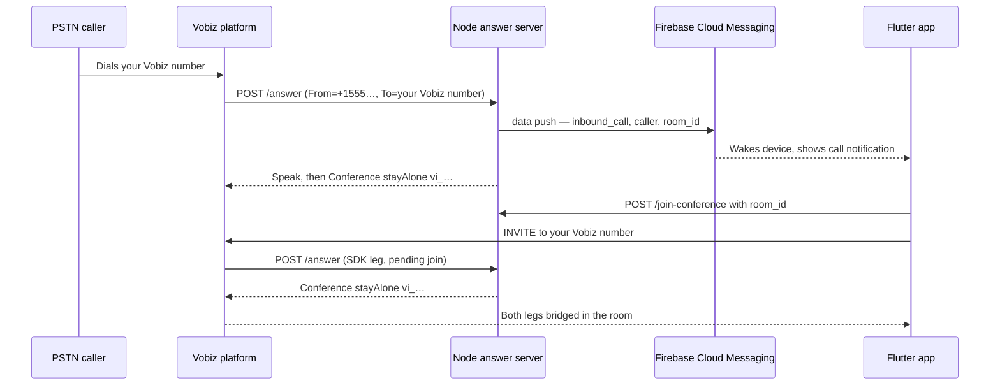

# Vobiz Flutter — SIP & WebRTC Voice Calling Sample

A complete, runnable [Vobiz](https://vobiz.ai) sample: a Flutter softphone that registers as a SIP
endpoint over WebSocket, carries audio over WebRTC, and a small Node webhook server that returns the
Vobiz Answer URL XML for both outbound and inbound calls.

[](./LICENSE)
[](https://flutter.dev)
[](https://dart.dev)
[](https://nodejs.org)
[](https://docs.vobiz.ai)

> **Platform support.** Despite the repository name, this is a **Flutter** project, not a native
> Android one. The SIP/WebRTC package (`vobiz_webrtc`) is plain Dart on top of `flutter_webrtc` and
> builds for **both Android and iOS**. The demo app in this repository ships with its **Android**
> platform configuration complete (permissions, Firebase/Google Services plugin, notification
> channel). To run the same Dart code on iOS, add the microphone privacy string, the VoIP background
> mode and a `GoogleService-Info.plist` as described in
> [`packages/vobiz_webrtc/PLATFORM_SETUP.md`](./vobiz_inbound/packages/vobiz_webrtc/PLATFORM_SETUP.md).

---

## Overview

Putting a real phone call inside a mobile app means solving three problems at once: registering a SIP
endpoint from a device, negotiating WebRTC media with a carrier-grade media server, and answering the
platform's webhook with the right call-control XML at the right moment. Each of those is easy to get
subtly wrong, and the failure modes (silent audio, one-way audio, calls that ring forever) look
identical from the outside. This repository shows all three working together end to end, with the
wiring visible rather than hidden behind a black box.

The Flutter app registers as a SIP endpoint on `registrar.vobiz.ai` over secure WebSocket
(`wss://registrar.vobiz.ai:5063/`, subprotocol `sip`), authenticates with SIP digest auth, and
negotiates an audio-only WebRTC session. The Node server is the Vobiz **Answer URL** target: when a
call leg needs instructions, Vobiz posts to it and the server replies with XML — `<Dial><Number>` to
reach the PSTN for an outbound call, `<Dial><User>` or `<Conference>` to ring the app for an inbound
call. Firebase Cloud Messaging wakes a backgrounded device so an inbound call still surfaces.

It is aimed at developers evaluating Vobiz for an in-app calling feature — field-service dispatch,
delivery, telehealth, support callbacks — and at teams who already have a Flutter app and want a
reference for the SIP registration and call-control layer rather than a finished product.

By the end of the setup below you will have: a device registered as a SIP endpoint, an outbound call
from the app that terminates on a real phone, an inbound call to your Vobiz number that rings inside
the app, and a push notification that surfaces that inbound call while the app is backgrounded.

## What you can build with it

- **In-app click-to-call for a field workforce.** Drivers or technicians call customers from the app
  using your Vobiz number as the caller ID, so personal mobile numbers are never exposed.
- **A softphone for a support or dispatch team.** Inbound calls to a published Vobiz number ring on
  whichever devices are registered, with accept, reject, mute, hold and hangup handled in-app.
- **Warm and cold transfer flows.** The backend's conference mode parks the PSTN leg in a room, dials
  the transfer target in, and lets the agent speak to the target before dropping out.
- **Hold with an announcement.** While the agent is on hold, the PSTN leg is redirected to a looping
  text-to-speech page instead of silence.
- **A second-line / merge experience.** Start a second call, swap between the two parties, then merge
  both legs into one conference.
- **A starting point for your own Flutter SDK integration.** `packages/vobiz_webrtc` is an
  independent package with its own tests, API reference and platform setup guide, consumable from any
  Flutter app.

## How it works

Two independent paths run through the same `/answer` webhook. The server decides which one it is
looking at from the `From` and `To` parameters Vobiz sends: a leg whose `From` starts with `sip:` (or
whose `RouteType` is `sip`) is the app's own leg; anything else addressed to your Vobiz number is an
inbound PSTN caller.

### Outbound calling

The user starts a call from the app to a destination number.

1. App registers its SIP endpoint (`REGISTER`, digest auth, `Expires: 3600`)
2. User dials a number
3. App creates a WebRTC offer, waits for ICE gathering, and sends a SIP `INVITE` carrying the SDP
4. Vobiz hits your `/answer` URL for that leg
5. Backend returns `<Dial callerId="..."><Number>...</Number></Dial>`
6. Vobiz dials the PSTN destination and bridges the two legs
7. Media flows over WebRTC between the app and Vobiz



### Inbound calling

Someone dials your Vobiz number and your app receives the call. The backend runs one of two inbound
strategies depending on how much is configured.

**Standard mode** — `VOBIZ_ACCOUNT_SID`, `VOBIZ_AUTH_TOKEN` or `PUBLIC_URL` not set:

1. App must already be SIP-registered
2. PSTN caller dials your Vobiz number
3. Vobiz hits your `/answer` URL
4. Backend fires an FCM push and returns `<Dial callerId="..." timeout="30"><User>sip:…@registrar.vobiz.ai</User></Dial>`
5. App receives an incoming SIP `INVITE`
6. User accepts or rejects
7. On accept, the app answers with an SDP answer and media starts

**Conference mode** — all three of `VOBIZ_ACCOUNT_SID`, `VOBIZ_AUTH_TOKEN` and `PUBLIC_URL` set:

1. Backend parks the PSTN caller with `<Speak>` followed by `<Conference stayAlone="true">vi_…</Conference>`
2. Backend sends an FCM data push carrying `caller` and `room_id`
3. The app answers by placing an outbound call to your own Vobiz number
4. That leg hits `/answer`, is recognised as the pending inbound join, and receives `<Conference stayAlone="true">` for the same room
5. Both parties are now in one room, which is what makes hold announcements, warm transfer, add-call and merge possible



## Architecture

### Repository layout

| Folder | Purpose |
| --- | --- |
| `vobiz_inbound/` | Full setup for both outbound and inbound calling (the main project) |
| `vobiz_inbound/Vobiz-RTC-demo/` | Node backend (Answer URL XML server) plus an optional browser test client |
| `vobiz_inbound/packages/vobiz_webrtc/` | Reusable Flutter SIP/WebRTC SDK package (`vobiz_webrtc`) |
| `vobiz_inbound/apps/vobiz_demo/` | Flutter demo app wired to the `vobiz_webrtc` package |
| `VOBIZ_SDK_PRD.md` | Product/requirements notes for the SDK scaffold |

### Backend (`vobiz_inbound/Vobiz-RTC-demo`)

| File | Responsibility |
| --- | --- |
| `server.js` | Whole backend in one file: routing of the `/answer` webhook, XML builders, in-memory call state, Vobiz REST helpers, FCM dispatch |
| `.env.example` | Template for the environment variables the server reads |
| `package.json` | `npm start` (server) and `npm run client` (static browser demo on port 8080) |
| `client/index.html`, `client/app.js` | Optional browser softphone that loads `vobiz-webrtc-sdk@1.0.2` from unpkg; useful for isolating device problems |

### Flutter SDK package (`vobiz_inbound/packages/vobiz_webrtc`)

| Path (under `lib/src/`) | Responsibility |
| --- | --- |
| `core/vobiz_client.dart` | The public `VobizClient` API — connect, call, accept, reject, hangup, mute, hold, transfer; owns call state and the event streams |
| `core/sdk_config.dart` | `SdkConfig`: registrar WebSocket URL, SIP server, backend URL, answer URL, auto-reconnect, debug, ICE and media constraints |
| `signaling/sip_service.dart` | SIP over secure WebSocket: message parser and builder, `REGISTER`/`INVITE`/`BYE`, MD5 digest auth (`qop=auth` supported), re-registration and keepalive timers |
| `signaling/socket_service.dart` | Raw WebSocket transport, negotiating the `sip` subprotocol |
| `webrtc/peer_service.dart` | `RTCPeerConnection` lifecycle: offer/answer, ICE gathering, local and remote audio tracks |
| `webrtc/ice_config.dart` | ICE servers; defaults to a public STUN server, accepts TURN credentials |
| `webrtc/media_constraints.dart` | Audio-only `getUserMedia` constraints with echo cancellation, noise suppression and AGC |
| `webrtc/audio_router.dart` | Speakerphone routing helper |
| `events/*.dart` | `ConnectionEvent`, `CallEvent`, `MediaEvent`, `ErrorEvent` payloads |
| `state/*.dart` | `ConnectionStateStatus`, `RegistrationState`, `CallStateStatus` enums |
| `models/**` | `CredentialConfig`, `TokenConfig`, `IncomingCall`, `OutgoingCall`, `CallStats`, `DtmfTone` |

### Flutter demo app (`vobiz_inbound/apps/vobiz_demo`)

| Path (under `lib/`) | Responsibility |
| --- | --- |
| `main.dart` | Initialises Firebase, registers the background message handler, starts `FcmService` |
| `integration/sdk_factory.dart` | Reads the three dart-defines and builds `VobizClient` with the registrar and backend URLs |
| `integration/dependency_injection.dart` | Creates and disposes the shared `SdkViewModel` exactly once |
| `presentation/viewmodels/sdk_view_model.dart` | Connection, registration and login state |
| `presentation/viewmodels/call_view_model.dart` | Call actions and the call-state machine driving the UI |
| `presentation/screens/` | Splash (auto-login), login, dialer, incoming call and active call screens |
| `presentation/widgets/` | Dialpad, call controls, connection banner, logo |
| `services/fcm_service.dart` | FCM token registration, background message handler, full-screen incoming-call notification with Answer/Decline actions |

## Prerequisites

**Accounts**

- A [Vobiz](https://vobiz.ai) account with a purchased number — this is your `CALLER_ID`
- A SIP endpoint (Vobiz Console → **Voice → Endpoints**); note the username and the password, which
  is shown once. The endpoint URI is `sip:<username>@registrar.vobiz.ai`
- A Voice Application with **Answer URL** `https://<public-url>/answer` and **Hangup URL**
  `https://<public-url>/hangup`, with your number linked to it
- A Firebase project if you want push wake-up (see [Push notifications](#push-notifications-and-inbound-wake-up))

**Runtimes and tools**

| Requirement | Version | Notes |
| --- | --- | --- |
| Node.js | 18 or newer | `firebase-admin` 13 requires Node 18+ |
| Flutter SDK | 3.19 or newer | `pubspec.yaml` pins `flutter: >=3.19.0` |
| Dart SDK | 3.3 or newer | `sdk: >=3.3.0 <4.0.0` |
| Android SDK | API 21+ | Java 17 toolchain, Android Gradle Plugin 8.11.1, Kotlin 2.2.20 |
| Xcode | Current release | Only if you are also building for iOS |
| ngrok or similar | any | The Answer URL must be reachable from the public internet |

A **physical device** is strongly recommended. Emulators work for signalling but are unreliable for
microphone capture and audio routing.

## Setup

1. **Clone the repository.**

   ```bash
   git clone https://github.com/vobiz-ai/Vobiz-Android-Sample.git
   cd Vobiz-Android-Sample/vobiz_inbound
   ```

2. **Install backend dependencies.**

   ```bash
   cd Vobiz-RTC-demo
   npm install
   ```

3. **Create the backend `.env`.**

   ```bash
   cp .env.example .env
   ```

   Fill in at minimum `CALLER_ID` and `SIP_ENDPOINT`. Placeholder markers such as
   `+<your-vobiz-number>` are detected and rejected at request time, so replace the angle brackets
   with real values.

4. **Start a public tunnel** so Vobiz can reach the webhook.

   ```bash
   ngrok http 3000
   ```

5. **Point the Voice Application at the tunnel.** In the Vobiz Console set the Answer URL to
   `https://<ngrok-url>/answer` and the Hangup URL to `https://<ngrok-url>/hangup`, and confirm your
   number is linked to that application.

6. *(Optional but recommended)* **Enable conference mode.** Add `VOBIZ_ACCOUNT_SID`,
   `VOBIZ_AUTH_TOKEN` and `PUBLIC_URL=https://<ngrok-url>` to `.env`. Without all three, the server
   starts in standard mode and hold announcements, warm transfer and merge are unavailable.

7. *(Optional)* **Set up Firebase** for inbound push wake-up — see
   [Push notifications and inbound wake-up](#push-notifications-and-inbound-wake-up).

8. **Fetch Flutter dependencies.**

   ```bash
   cd ../apps/vobiz_demo
   flutter pub get
   ```

9. **Confirm your device is visible.**

   ```bash
   flutter devices
   ```

## Configuration

### Backend environment variables (`Vobiz-RTC-demo/.env`)

Every variable `server.js` actually reads:

| Variable | Required | Default | Description |
| --- | --- | --- | --- |
| `CALLER_ID` | Yes | `''` | Your Vobiz number in E.164. Used as `<Dial callerId="…">` on both directions and as the number the app dials to join an inbound conference. A missing or placeholder value makes `/answer` reply with a spoken configuration error. |
| `SIP_ENDPOINT` | Yes (for inbound) | — | Where inbound PSTN calls are routed: `sip:<username>@registrar.vobiz.ai`. Validated to start with `sip:` and contain `@`. |
| `DEFAULT_DESTINATION` | No | — | Fallback outbound destination used when `/answer` cannot resolve a number from the INVITE or from a prior `POST /call`. |
| `DEFAULT_COUNTRY_CODE` | No | `91` | Prefix applied when normalising a 10-digit (or leading-zero 11-digit) number to E.164. Set this to your own country code, for example `1`. |
| `VOBIZ_ACCOUNT_SID` | No | `''` | Vobiz account SID. Enables the REST-driven features: hold announcement, transfer, warm transfer, add-call, second call, swap, merge, and server-side hangup. |
| `VOBIZ_AUTH_TOKEN` | No | `''` | Vobiz auth token, sent with the SID as HTTP Basic auth to `https://api.vobiz.ai/api/v1`. |
| `PUBLIC_URL` | No | `''` | Your public HTTPS base URL (no trailing slash). The server uses it to build the `answer_url` and `hangup_url` it hands to the Vobiz REST API for conference legs and the hold loop. |

The listen port is fixed at **3000** in `server.js`.

Conference mode is active only when `VOBIZ_ACCOUNT_SID`, `VOBIZ_AUTH_TOKEN` **and** `PUBLIC_URL` are
all set; the banner printed at startup tells you which mode you are in.

### Flutter dart-defines (`apps/vobiz_demo`)

Read by `lib/integration/sdk_factory.dart` via `String.fromEnvironment`:

| Define | Required | Default | Description |
| --- | --- | --- | --- |
| `VOBIZ_BACKEND_URL` | No | `http://10.0.2.2:3000` | Base URL of the Node backend. The default is the Android emulator's alias for the host machine; use `http://127.0.0.1:3000` with `adb reverse` on a physical device, or the LAN/tunnel URL. |
| `VOBIZ_ANSWER_URL` | No | *(empty → `null`)* | Public answer webhook URL recorded on `SdkConfig.answerUrl`. The demo routes inbound calls through the Answer URL configured in the Vobiz Console, so this can be left unset. |
| `VOBIZ_CALLER_ID` | Yes for inbound | *(empty)* | Your Vobiz number in E.164. The app dials this number to join the conference room when answering an inbound call, so inbound answering does nothing while it is empty. |

Values that are not dart-defines, but are worth knowing, all defaulted in `SdkConfig`:

| Setting | Value in the demo |
| --- | --- |
| `wsUrl` | `wss://registrar.vobiz.ai:5063/` |
| `sipServer` | `registrar.vobiz.ai` |
| `autoReconnect` | `true` — exponential backoff, 1 s doubling to a 30 s ceiling |
| `debug` | `true` — verbose SIP/WebRTC logging |
| `iceConfig` | `stun:stun.l.google.com:19302` |
| `mediaConstraints` | Audio only; echo cancellation, noise suppression and AGC on |

SIP credentials are not build-time configuration: they are typed into the login screen and, when
"Remember me" is ticked, stored with `flutter_secure_storage`.

## Running it

Four terminals. The first two are always needed; the fourth is optional.

### Terminal 1 — backend

```bash
cd vobiz_inbound/Vobiz-RTC-demo
npm install
npm start
```

The backend listens on port `3000` and prints its mode banner. Expect
`✓ Conference mode active` when all three REST variables are set, otherwise `⚠ Standard mode`. If
Firebase is configured you also get `[FCM] Firebase Admin initialized`.

### Terminal 2 — public webhook tunnel

```bash
ngrok http 3000
```

Then set these in the Vobiz Console:

- Answer URL: `https://<ngrok-url>/answer`
- Hangup URL: `https://<ngrok-url>/hangup`

### Terminal 3 — Flutter app

```bash
cd vobiz_inbound/apps/vobiz_demo
flutter pub get
flutter devices
adb reverse tcp:3000 tcp:3000
flutter run -d <device-id> \
  --dart-define=VOBIZ_BACKEND_URL=http://127.0.0.1:3000 \
  --dart-define=VOBIZ_CALLER_ID=+15550003333
```

On an Android emulator you can drop both `adb reverse` and `VOBIZ_BACKEND_URL`; the default
`http://10.0.2.2:3000` already points at the host. Log in with your SIP endpoint username and
password; the connection banner should settle on a registered state.

### Terminal 4 — optional web demo client

```bash
cd vobiz_inbound/Vobiz-RTC-demo
npm run client
```

Open `http://localhost:8080`. This browser softphone talks to the same registrar and is a quick way
to tell a device problem apart from an account or webhook problem.

### Testing both directions

1. Start the backend and the tunnel.
2. Start the app and log in with your Vobiz endpoint credentials.
3. **Outbound test** — enter an E.164 number in the app and tap Call. The backend log should show the
   `[answer-route] … branch=sdk-leg` line followed by `[outbound] Dialing +…`, and the destination
   phone should ring.
4. **Inbound test** — keep the app registered and online, dial your Vobiz number from an external
   phone, confirm the incoming call screen appears, accept, and verify two-way audio.
5. **Hold test** (conference mode only) — put the call on hold and confirm the PSTN side hears the
   looping announcement rather than silence.

## Backend and SDK reference

### Backend endpoints

Called by the Vobiz platform:

| Endpoint | Method | Purpose |
| --- | --- | --- |
| `/answer`, `/` | GET, POST | The Answer URL. Classifies the leg and returns `<Dial><Number>`, `<Dial><User>` or `<Conference>` |
| `/hangup` | GET, POST | Clears call state and returns an empty `<Response>`. Any request whose event parameter contains `hangup` is treated the same way |
| `/conference-join` | GET | Answer URL for legs the server dials into a room; `?type=warm`, `?type=added` or `?type=second` decides which UUID slot the leg is stored in |
| `/conference-status` | POST | Conference status callback |
| `/pstn-status` | POST | Hangup callback for server-dialled PSTN legs |
| `/hold-loop`, `/hold-announcement` | GET, POST | Looping `<Speak>` XML the held PSTN leg is redirected to |
| `/transfer-bridge` | GET, POST | XML that bridges a transferred leg to its target |

Called by the app or the browser client:

| Endpoint | Method | Purpose |
| --- | --- | --- |
| `/call` | POST | Optional helper: stores the outbound destination (`to`) so `/answer` can use it. Both demo clients instead pass the destination in the SIP `INVITE`, which reaches `/answer` as `To` |
| `/register-token` | POST | Stores a `username` / FCM `token` / `backend_url` triple in memory |
| `/pending-call` | GET | Returns `{pending, caller, roomId, joinNumber}`; the app polls this every 2 s as a fallback when push delivery is slow |
| `/join-conference` | POST | Killed-app recovery: confirms a room is still waiting before the app dials in |
| `/answer-inbound` | POST | Acknowledges a pending inbound call |
| `/decline-inbound` | POST | Hangs up the waiting PSTN leg through the Vobiz REST API |
| `/hold-start`, `/resume` | POST | Redirect the PSTN leg to the hold loop and back into the room |
| `/transfer` | POST | Cold transfer to `to` |
| `/warm-transfer/start` | POST | Dials the transfer target into the room so the agent can brief them |
| `/add-call`, `/remove-added-call` | POST | Add or drop a third party |
| `/second-call`, `/swap-calls`, `/merge-calls`, `/end-second-call` | POST | Second-line handling and merge |
| `/conference` | POST | Legacy room creation from two call IDs |

### Vobiz XML elements used

| Element | Where | Notes |
| --- | --- | --- |
| `<Response>` | Every reply | Root element |
| `<Dial callerId="…" timeout="…">` | Outbound and standard-mode inbound | `timeout="30"` on the inbound `<User>` dial |
| `<Number>` | Outbound | The E.164 PSTN destination |
| `<User>` | Standard-mode inbound | `sip:<username>@registrar.vobiz.ai` from `SIP_ENDPOINT` |
| `<Conference stayAlone="true">` | Conference mode | Room name `vi_<timestamp>`; `stayAlone` keeps the first party in the room while waiting |
| `<Speak>` | Hold loop, waiting prompt, configuration errors | Text-to-speech |

### Vobiz REST API calls

The backend calls the Plivo-compatible REST API at `https://api.vobiz.ai/api/v1` with HTTP Basic
auth built from `VOBIZ_ACCOUNT_SID` and `VOBIZ_AUTH_TOKEN`:

| Call | Used for |
| --- | --- |
| `POST /Account/{sid}/Call/` | Dialling the PSTN caller, warm-transfer target, added party or second call into a conference room |
| `POST /Account/{sid}/Call/{uuid}/` | Redirecting a live leg (`aleg_url`) to the hold loop or back to the room |
| `DELETE /Account/{sid}/Call/{uuid}/` | Hanging up a specific leg — used by `/decline-inbound` and by hangup cleanup |

### `VobizClient` surface

```dart
final client = VobizClient(
  config: SdkConfig(
    wsUrl: 'wss://registrar.vobiz.ai:5063/',
    sipServer: 'registrar.vobiz.ai',
    backendUrl: 'http://127.0.0.1:3000',
    autoReconnect: true,
    debug: true,
  ),
);

await client.connectWithCredentials(
  const CredentialConfig(username: 'your-endpoint-user', password: 'your-endpoint-password'),
);

final callId = await client.makeCall('+15550003333');
```

| Member | Kind | Description |
| --- | --- | --- |
| `connect`, `connectWithCredentials` | `Future<void>` | Opens the WebSocket and registers the endpoint |
| `disconnect`, `dispose` | `Future<void>` | Tears down registration, peer connection and streams |
| `makeCall(destination)` | `Future<String>` | Creates the offer, waits for ICE, sends the `INVITE`; returns a local call id |
| `acceptCall`, `rejectCall`, `hangup` | `Future<void>` | Inbound handling and teardown |
| `mute`, `unmute` | `Future<void>` | Toggles the local audio track; `isMuted` reflects the state |
| `hold`, `resume` | `Future<void>` | Drive `/hold-start` and `/resume` on the backend |
| `transfer`, `warmTransferStart`, `warmTransferComplete` | `Future<void>` | Cold and warm transfer |
| `addCall`, `removeAddedCall`, `startSecondCall`, `swapCalls`, `mergeCalls`, `endSecondCall` | `Future<void>` | Multi-party handling |
| `connectionEvents`, `callEvents`, `mediaEvents`, `errorEvents` | `Stream` | Event streams the view models subscribe to |
| `connectionState`, `registrationState`, `currentCall`, `currentCallId`, `isConnected`, `isMuted` | getters | Current state |

Backend calls made by the client are non-fatal: a failure is logged and the call continues.

See [`packages/vobiz_webrtc/README.md`](./vobiz_inbound/packages/vobiz_webrtc/README.md),
[`API_REFERENCE.md`](./vobiz_inbound/packages/vobiz_webrtc/API_REFERENCE.md),
[`CREDENTIALS.md`](./vobiz_inbound/packages/vobiz_webrtc/CREDENTIALS.md) and
[`PLATFORM_SETUP.md`](./vobiz_inbound/packages/vobiz_webrtc/PLATFORM_SETUP.md) for package-level
detail.

## Push notifications and inbound wake-up

Inbound calls ring immediately whenever the app is in the foreground and SIP-registered. Push exists
for the other cases: the app backgrounded, or the process killed.

**Backend side.** `server.js` initialises the Firebase Admin SDK from a `serviceAccountKey.json` file
placed in `Vobiz-RTC-demo/`. If the file is absent the server logs
`[FCM] Firebase Admin init failed (push notifications disabled)` and keeps running — everything else
still works, you simply lose wake-up. When an inbound PSTN call arrives, the server sends a
high-priority **data** message (TTL 30 s) to every registered token:

```json
{ "type": "inbound_call", "caller": "+15550003333", "backend_url": "http://…", "room_id": "vi_1730000000000" }
```

Tokens come from `POST /register-token` and live in an in-memory map, so they are lost on restart —
the dialer screen re-registers the token every time it loads.

**App side.** `lib/services/fcm_service.dart` handles all three lifecycle cases:

| App state | What happens |
| --- | --- |
| Foreground | `FirebaseMessaging.onMessage` emits on `foregroundInboundCalls`; the dialer shows an in-app Answer/Reject dialog |
| Backgrounded | The top-level `firebaseMessagingBackgroundHandler` runs in a background isolate, discards messages older than 30 s, and posts a full-screen-intent notification on the `vobiz_incoming_calls` channel with **Answer** and **Decline** actions |
| Killed | The same background handler posts the notification. Tapping **Answer** launches the app; `wasLaunchedFromAnswerAction()` detects it on the splash screen and the dialer joins the waiting conference room |

**Decline** posts to `/decline-inbound`, which hangs up the waiting PSTN leg through the REST API.
**Answer** makes the app dial `VOBIZ_CALLER_ID`, which is why that dart-define is required for
inbound. As a safety net for slow or missing push delivery (common on emulators), the dialer also
polls `GET /pending-call` every two seconds and raises the same dialog or notification.

**Setup steps**

1. Create a Firebase project and add an Android app with the application id `com.example.vobiz_mobile`
   (or change `applicationId` in `android/app/build.gradle.kts` to match your own).
2. Download `google-services.json` and place it in `apps/vobiz_demo/android/app/`. The
   `com.google.gms.google-services` Gradle plugin is already applied.
3. In the Firebase console open **Project settings → Service accounts → Generate new private key**
   and save the JSON as `Vobiz-RTC-demo/serviceAccountKey.json`.
4. Restart the backend and look for `[FCM] Firebase Admin initialized`.
5. Log in on the device; `Push token registered for <username>` appears in the backend log.

Both files are already covered by `.gitignore`. For iOS, add `GoogleService-Info.plist`, an APNs key
in the Firebase console, and the VoIP background mode before expecting wake-up there.

## Troubleshooting

| Symptom | Likely cause | Fix |
| --- | --- | --- |
| Caller hears "Server misconfigured: CALLER_ID not set" or "…still has placeholder markers" | `CALLER_ID` is empty or still contains the `<…>` template markers from `.env.example` | Put a real E.164 number in `.env` and restart the backend |
| Caller hears "Server misconfigured: SIP_ENDPOINT must be sip:username@registrar.vobiz.ai" | `SIP_ENDPOINT` missing, or not in `sip:user@host` form | Copy the endpoint URI from **Voice → Endpoints** into `.env` |
| Outbound attempt returns `400 Cannot call your own number` | Destination normalises to the same digits as `CALLER_ID` | Dial a different number; self-calls are rejected on purpose |
| `400 No destination. POST /call first or set DEFAULT_DESTINATION.` | `/answer` could not resolve a number from the INVITE and nothing was stored | Dial from the app's dialer, or set `DEFAULT_DESTINATION` in `.env` |
| App never reaches the registered state; an `errorEvent` with code `registration_failed` | Wrong SIP username/password, or the endpoint was deleted | Re-copy the credentials; the endpoint password is shown only once, so regenerate the endpoint if it was lost |
| Call rings, then an `errorEvent` with code `call_timeout` after 30 s | Vobiz never got usable instructions — tunnel down, or the Answer URL in the console does not match the current ngrok URL | Restart the tunnel and update the Voice Application's Answer URL |
| Call connects but there is no audio, or audio one way only | `RECORD_AUDIO` not granted, or media blocked by a symmetric NAT with only STUN configured | Grant the microphone permission, test on a physical device, and supply TURN credentials through `IceConfig` |
| Backend logs no `POST /pending-call` or `/register-token` traffic from the device | The app cannot reach the backend: on a physical device the default `http://10.0.2.2:3000` is unreachable | Run `adb reverse tcp:3000 tcp:3000` and pass `--dart-define=VOBIZ_BACKEND_URL=http://127.0.0.1:3000` |
| Backend prints `[FCM] Firebase Admin init failed (push notifications disabled)` | `serviceAccountKey.json` is missing or invalid | Generate a service-account key in the Firebase console and save it in `Vobiz-RTC-demo/` |
| `[FCM] No registered tokens` when an inbound call arrives | Tokens are held in memory and were lost on the last backend restart | Reopen the dialer screen on the device, which re-registers the token |
| Hold plays silence and the startup banner said `⚠ Standard mode` | One of `VOBIZ_ACCOUNT_SID`, `VOBIZ_AUTH_TOKEN`, `PUBLIC_URL` is missing, so conference mode is off | Set all three in `.env` and restart |
| Answering an inbound call from the notification does nothing | `VOBIZ_CALLER_ID` was not passed, so the app has no number to dial into the room | Re-run with `--dart-define=VOBIZ_CALLER_ID=+15550003333` |
| A 10-digit number dials the wrong country | `DEFAULT_COUNTRY_CODE` defaults to `91` | Set `DEFAULT_COUNTRY_CODE` to your country code, or always dial in full E.164 |

## Security notes

This is a sample. Read this section before pointing it at anything that matters.

- **SIP credentials live on the device.** The login screen stores the endpoint username and password
  with `flutter_secure_storage` (Android Keystore / iOS Keychain) when "Remember me" is ticked, with
  only the flag itself in `SharedPreferences`. Anyone holding those credentials can register and
  place calls billed to your account, so issue one endpoint per user, rotate on device loss, and do
  not ship a shared endpoint inside an APK.
- **The demo enables cleartext traffic.** `android:usesCleartextTraffic="true"` in the manifest
  exists so the app can reach a local `http://…:3000` backend. Remove it, and serve the backend over
  HTTPS, for anything beyond local testing.
- **The FCM service-account key is a high-value secret.** `serviceAccountKey.json` grants
  message-sending rights on your Firebase project. Keep it out of the image and out of version
  control; inject it as a mounted secret in deployment.
- **The backend has no authentication.** Every route — `/call`, `/register-token`,
  `/decline-inbound`, `/transfer`, `/merge-calls` — accepts any caller. Keep it behind a tunnel you
  control during testing, and add request authentication plus webhook signature verification before
  exposing it publicly.
- **Gitignored secrets.** The root `.gitignore` already excludes `**/.env`, `**/serviceAccountKey.json`,
  `**/google-services.json` and `**/GoogleService-Info.plist`. Check `git status` before committing
  anyway, and never commit real phone numbers or a live ngrok URL.
- **Logs.** `redactSensitiveParams` masks any parameter whose name matches `password`, `pass`,
  `token` or `secret`, but caller and destination numbers are still printed in full. Treat backend
  stdout as containing personal data and scrub it before sharing a log.
- **Vobiz REST credentials stay server-side.** `VOBIZ_ACCOUNT_SID` and `VOBIZ_AUTH_TOKEN` are sent as
  HTTP Basic auth to `api.vobiz.ai`. They belong in the backend `.env` only — never in a dart-define,
  which is compiled into the app binary.

## Roadmap

> Planned improvements to this example. Ideas and pull requests are welcome —
> open an issue to discuss anything here.

- [ ] Complete the iOS platform pass for the demo app — microphone privacy string, VoIP background
      mode, `GoogleService-Info.plist` — so the same Dart code runs on iOS with no manual edits.
- [ ] Add an APNs path alongside FCM, so inbound wake-up behaves identically on both platforms.
- [ ] Integrate the native call UIs — CallKit on iOS and ConnectionService on Android — instead of
      the current full-screen-intent notification.
- [ ] Replace the two-second `/pending-call` poll in `dialer_screen.dart` with an event-driven path
      once push delivery is confirmed reliable on both platforms.
- [ ] Persist backend state. `lastDialedNumber`, `activeCall` and `registeredPushTokens` are
      in-memory in `server.js`, so a restart drops them and only one call can be tracked at a time;
      move them to Redis or a small database keyed by endpoint.
- [ ] Add a CI workflow running `flutter analyze`, `flutter test` and a formatting check on pull
      requests — the unit suite in `packages/vobiz_webrtc/test/` is currently run by hand.
- [ ] Document and ship a TURN example. `IceConfig` defaults to a public STUN server, which is enough
      for most networks but not for symmetric NAT.

## Contributing

Issues and pull requests are welcome. Before opening a PR:

```bash
# Flutter package and app
cd vobiz_inbound/packages/vobiz_webrtc && flutter test
cd ../../apps/vobiz_demo && flutter analyze && flutter test

# Backend — check it boots and prints the expected mode banner
cd ../../Vobiz-RTC-demo && npm install && npm start
```

Keep changes scoped, describe how you tested the call path you touched (outbound, inbound, hold,
transfer), and never include real credentials, real phone numbers or tunnel URLs in code, logs or
screenshots.

## License

Released under the [MIT License](./LICENSE) © Vobiz.

MIT is permissive: you may use, modify, and redistribute this code, including in
closed-source commercial products, provided the copyright notice and licence text
are retained. There is no warranty. If your organisation needs a different
licensing arrangement, contact [piyush@vobiz.ai](mailto:piyush@vobiz.ai).

## Built by Team Vobiz

[Vobiz](https://vobiz.ai) is a programmable voice and SIP-trunking platform for
voice APIs, SIP trunking, and AI voice agents. This repository is built and
maintained by the Vobiz team.

**Maintainer:** Piyush Sahoo — [piyush@vobiz.ai](mailto:piyush@vobiz.ai) · [LinkedIn](https://www.linkedin.com/in/piyush-s713/)

Questions, or want to talk through an integration? Open an issue on this repo,
or reach out directly at [piyush@vobiz.ai](mailto:piyush@vobiz.ai).

**Useful links:** [Docs](https://docs.vobiz.ai) · [API reference](https://docs.vobiz.ai/api-reference) · [Sign up](https://vobiz.ai)
