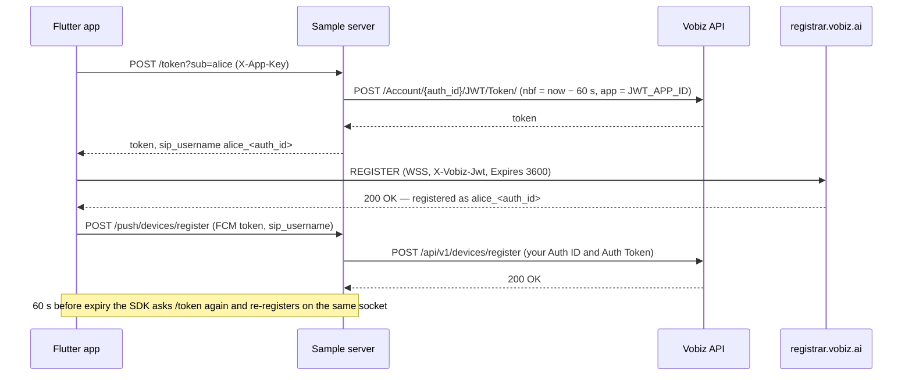
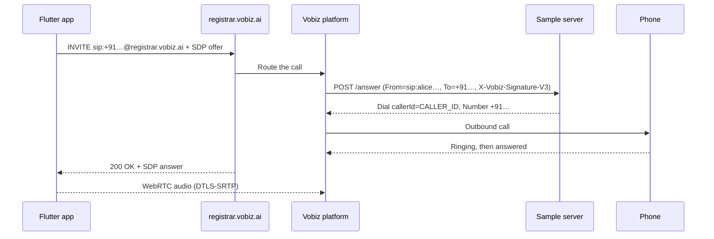
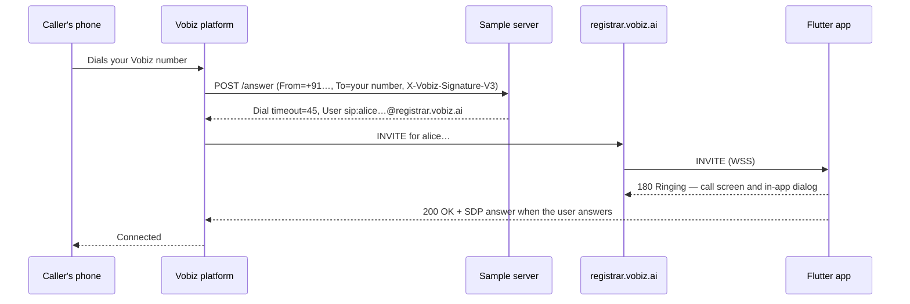
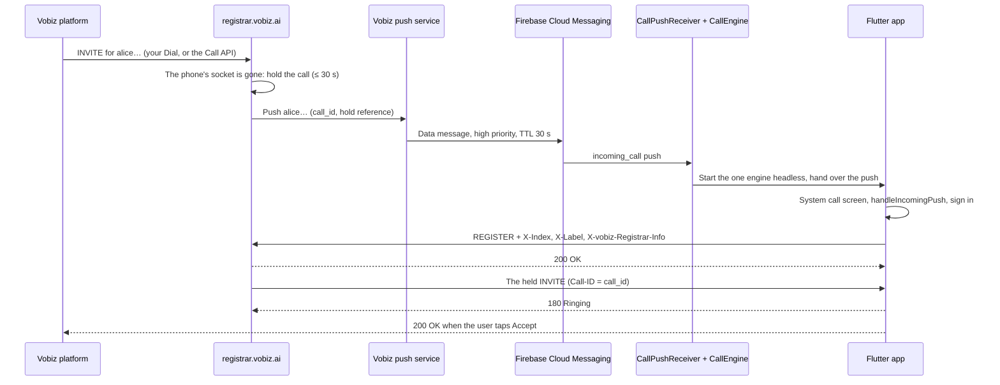
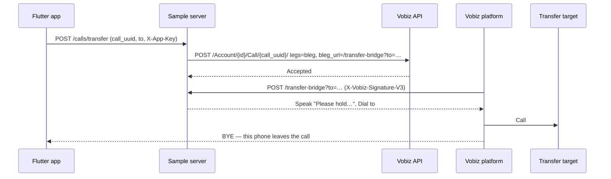
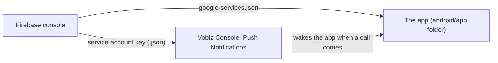
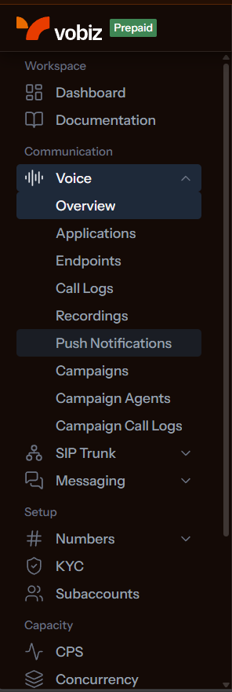
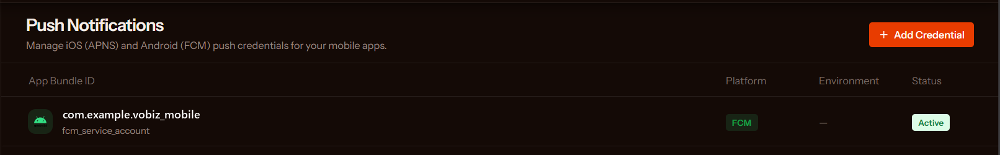
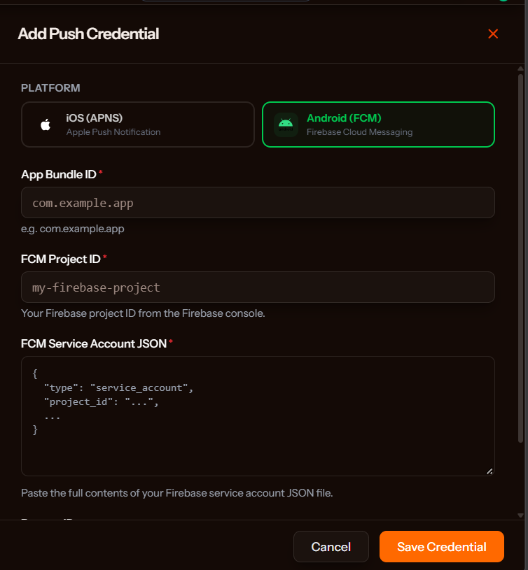

# Vobiz Flutter — SIP & WebRTC Voice Calling Sample

A complete, runnable [Vobiz](https://vobiz.ai) sample: a Flutter softphone built on the
[`vobiz_webrtc`](https://pub.dev/packages/vobiz_webrtc) SDK that calls phones, is called on your Vobiz
number, and **rings even when the app is closed** through Vobiz push — plus the small Node server it
needs: the Answer URL, access tokens, push registration and transfer, with your Auth Token kept on
the server.

[](./LICENSE)
[](https://pub.dev/packages/vobiz_webrtc)
[](https://flutter.dev)
[](https://dart.dev)
[](https://nodejs.org)
[](https://docs.vobiz.ai)

> **Platform support.** Despite the repository name, this is a **Flutter** project. The SDK and the
> app's Dart code build for **Android and iOS**. **Android is complete**, including calls to a closed
> app (Vobiz push, the system call screen, a foreground service during calls). **iOS rings only while
> the app is open**: the SDK has no PushKit/CallKit path yet, so there is no closed-app ringing on iOS.

---

## Table of contents

- [Overview](#overview)
- [Features](#features)
- [How it works](#how-it-works)
  - [Signing in](#signing-in)
  - [Outbound calls](#outbound-calls)
  - [Inbound calls with the app open](#inbound-calls-with-the-app-open)
  - [Inbound calls with the app closed (Vobiz push)](#inbound-calls-with-the-app-closed-vobiz-push)
  - [Blind transfer](#blind-transfer)
- [Architecture](#architecture)
- [Prerequisites](#prerequisites)
- [Setup](#setup)
  - [Ring the app when it is closed (Firebase and Vobiz push)](#3-ring-the-app-when-it-is-closed-firebase-and-vobiz-push)
- [Configuration](#configuration)
- [Running and testing](#running-and-testing)
- [Using the SDK in your own app](#using-the-sdk-in-your-own-app)
- [Sample server reference](#sample-server-reference)
- [Troubleshooting](#troubleshooting)
- [Security notes](#security-notes)
- [Limitations](#limitations)
- [Roadmap](#roadmap)
- [Contributing](#contributing)
- [License](#license)

## Overview

Putting a real phone call inside a mobile app means solving four problems at once: signing a device in
to a SIP registrar, negotiating WebRTC audio with a carrier-grade media server, answering the
platform's webhook with the right call-control XML, and ringing a phone whose app the operating system
has already killed. Each is easy to get subtly wrong, and the failures (silent audio, one-way audio,
calls that ring forever, calls that never ring) look the same from the outside. This repository shows
all four working together, with the wiring visible.

It has three parts:

| Part | What it does |
| --- | --- |
| **Flutter app** (`vobiz_calling/apps/vobiz_demo`) | Signs in to `registrar.vobiz.ai` over secure WebSocket, places and answers calls with WebRTC audio, and handles Vobiz's incoming-call push when it is closed. |
| **Sample server** (`vobiz_calling/Vobiz-RTC-demo`) | Your Vobiz application's **Answer URL**, plus the routes the app must not do itself because they need your Auth Token: access tokens, push registration and transfer. |
| **Vobiz** | Registrar, media servers, the carrier network, and the push service that wakes the app. |

It is aimed at developers evaluating Vobiz for in-app calling — field service, delivery, telehealth,
support callbacks — and at teams who already have a Flutter app and want a reference for sign-in, call
control and closed-app ringing rather than a finished product.

By the end of [Setup](#setup) you will have a phone signed in to Vobiz, an outbound call from the app
to a real phone, a call to your Vobiz number that rings the app, and the same call ringing the app
after you have swiped it away.

## Features

**Calling**
- ✅ Outbound calls to phone numbers, with your Vobiz number as the caller ID
- ✅ Inbound calls to your Vobiz number, ringing every phone signed in as the same SIP user
- ✅ Calls to another app or SIP phone by name (the SDK's `dialUser`, handled by the server)

**Sign-in**
- ✅ **SIP endpoint**: an endpoint's username and password from the Vobiz Console
- ✅ **Access token (JWT)**: minted by the sample server, renewed by the SDK before it expires
- ✅ "Remember me" in encrypted storage (Android Keystore / iOS Keychain), with automatic sign-in

**Calls to a closed app (Android)**
- ✅ **Vobiz push-to-wake**: Vobiz holds the call, pushes the phone, and the app claims the call — no push server of your own
- ✅ The system incoming-call screen, full screen on a locked phone (`flutter_callkit_incoming`)
- ✅ A `phoneCall|microphone` foreground service, so the microphone keeps working in the background

**In a call**
- ✅ Mute, speaker, hold and resume (SIP re-INVITE; the other party hears hold music)
- ✅ Keypad for IVR menus (DTMF: RFC 4733 when negotiated, else SIP INFO)
- ✅ Blind transfer of the other party to a number or SIP user
- ✅ Call timer, caller ID display, and "Hang up" on the ongoing-call notification

**Reliability and security (from the SDK and the server)**
- ✅ Automatic reconnect, re-registration when the app returns to the foreground, ICE restart after a network drop
- ✅ The Auth Token never leaves the server; every Vobiz webhook is checked against its `X-Vobiz-Signature`
- ✅ The app's routes on the server need an app key; plain HTTP is allowed in debug builds only

## How it works

One Vobiz **application** ties everything together: your number and your SIP endpoint are attached to
it, and its **Answer URL** is the sample server's `/answer`. Vobiz asks that URL what to do with every
call leg, and the server tells the two kinds apart by the `From` parameter: a leg whose `From` starts
with `sip:` is the app calling out; anything else is someone calling your number.

### Signing in

The app signs in one of two ways. Both register over `wss://registrar.vobiz.ai:5063/` for an hour
(`Expires: 3600`) and refresh before that runs out.

- **SIP endpoint.** The app sends the endpoint's username and password (SIP digest). Simple, and fine
  for a sample; in production each user needs their own endpoint, issued by your backend.
- **Access token (recommended).** The app never holds a long-lived secret:

1. The app asks the sample server for a token for an identity (`POST /token?sub=alice`, with the app key)
2. The server mints it with your Auth Token (`POST /Account/{auth_id}/JWT/Token/`), with `nbf` a minute in the past and `app` set to your application
3. The app registers with the token in `X-Vobiz-Jwt`; its SIP identity is `alice_<your Auth ID>`
4. 60 seconds before the token expires, the SDK asks for a new one and re-registers on the same socket, without touching a call
5. The app registers the phone for push through the server, which adds your Auth Token



### Outbound calls

1. The user dials a number; the app turns it into E.164 (`9XXXXXXXXX` → `+919XXXXXXXXX`)
2. The SDK creates a WebRTC offer and sends `INVITE sip:+91…@registrar.vobiz.ai` with the SDP
3. Vobiz asks the Answer URL of the endpoint's application (or of the token's `app`)
4. The server checks the signature and answers `<Dial callerId="CALLER_ID"><Number>+91…</Number></Dial>`
5. Vobiz dials the phone over the carrier network and bridges the two legs
6. The app gets `200 OK` with the SDP answer, and audio flows



### Inbound calls with the app open

1. Someone dials your Vobiz number
2. Vobiz asks the Answer URL of the number's application
3. The server answers `<Dial timeout="45"><User>sip:alice…@registrar.vobiz.ai</User></Dial>`, one `<User>` per `SIP_ENDPOINT`; the caller's own number reaches the app
4. The registrar sends the `INVITE` to every phone signed in as that SIP user
5. The app shows the system call screen and an in-app dialog; the first phone to answer gets the call



### Inbound calls with the app closed (Vobiz push)

When Android has closed the app, its WebSocket is gone, but the registrar keeps the phone's
registration (the SDK's User-Agent marks it push-capable) until it expires. A call to that SIP user then
takes Vobiz's push path:

1. The registrar cannot reach the phone, so it **holds the call for up to 30 seconds**
2. Vobiz's push service sends a data-only, high-priority Firebase message (TTL 30 s) to every phone registered for that SIP user, using the Firebase credential you saved in the Console for the app's package name
3. `CallPushReceiver` (Android) takes the push and starts the app's one Flutter engine **headless** (`CallEngine`)
4. `PhoneController` shows the system call screen, hands the push to `client.handleIncomingPush`, and signs in with the saved sign-in
5. The sign-in's `REGISTER` carries the hold reference (`X-Index`, `X-Label`, `X-vobiz-Registrar-Info`); the registrar answers `200 OK` and sends the held `INVITE`, whose Call-ID is the push's `call_id`
6. The phone rings; **Accept** opens the app on the same engine and answers. **Decline** still claims the call, then turns it away, so the caller hears busy at once instead of ringing out



On an emulator running a debug build, the phone rang about 8 seconds after the call was placed, well
inside the 30-second hold; release builds on real phones start faster. A phone closed for longer than
its last registration (an hour) is busy to callers until the app is opened again.

### Blind transfer

Transfer needs the Auth Token, so the app asks the server, giving its own CallUUID:

1. The user taps **Transfer** and enters a number or SIP user name
2. The app sends `POST /calls/transfer` with `call_uuid` (`client.callUuid`) and `to`, plus the app key
3. The server calls the Vobiz Transfer API on that call with `legs=bleg`: the leg bridged to the app — the other party — fetches new XML from `/transfer-bridge?to=…`
4. `/transfer-bridge` answers `<Speak>Please hold…</Speak><Dial><Number>…</Number></Dial>`; the app's own leg is released



## Architecture

### Repository layout

| Path | Purpose |
| --- | --- |
| `vobiz_calling/` | Everything for calling in **both directions**: outbound calls from the app and inbound calls to your number |
| `vobiz_calling/apps/vobiz_demo/` | The Flutter app |
| `vobiz_calling/Vobiz-RTC-demo/` | The sample server (`server.js`, `test/`), plus an optional browser softphone in `client/` |
| `VOBIZ_SDK_PRD.md` | The original product-requirements notes for the 0.1.0 scaffold. Historical: this README describes the current design |

The SDK itself is the [`vobiz_webrtc`](https://pub.dev/packages/vobiz_webrtc) package on pub.dev; this
repository no longer carries a copy of it.

### The app (`apps/vobiz_demo/lib`)

| Path | Responsibility |
| --- | --- |
| `main.dart` | Starts Firebase (if configured), then the app. Also runs headless when a push starts the app |
| `integration/app_config.dart` | The dart-defines and the one `VobizClient` (`SdkConfig`) |
| `integration/dependency_injection.dart` | Creates the `PhoneController` before any screen, so it works with no screen at all |
| `phone/phone_controller.dart` | Sign-in (endpoint or access token), saved sign-in, the call and its controls, the system call screen, Vobiz push (claim, accept, decline, expiry), push registration, the call's foreground service |
| `phone/numbers.dart` | What the user typed → E.164; SIP URIs → a display name |
| `services/backend_api.dart` | The sample server's app routes: the token provider, push registration (`VobizPushDevices` pointed at the server), transfer |
| `services/push/push_service.dart` | Firebase: the push token, token refresh, pushes while the app is open |
| `services/push/call_screen.dart` | The system incoming-call screen (`flutter_callkit_incoming`) |
| `services/push/call_platform.dart` | The method channel `vobiz.demo/call` to the Android code below |
| `presentation/screens/` | Splash, sign-in, dialer, incoming-call dialog, call screen |
| `presentation/widgets/` | Call controls and the in-call keypad, the logo |

### The Android layer (`android/app/src/main/kotlin/...`)

| File | Responsibility |
| --- | --- |
| `CallPushReceiver.kt` | Receives Vobiz's call pushes from the same broadcast `firebase_messaging` listens to, and hands them to `CallEngine` |
| `CallEngine.kt` | The app's **one** Flutter engine, cached and started headless by a push. It runs the SIP connection and the UI together and outlives the activity, so Accept opens the app on the engine that already signed in |
| `CallService.kt` | The call's foreground service (`phoneCall|microphone`), with **Hang up** on its notification |
| `MainActivity.kt` | Uses the cached engine; shows over the lock screen only when opened by Accept |

There is deliberately **no Dart background message handler**: it would start a second engine for every
push, with a second SIP connection that does not know about the first.

### The sample server (`Vobiz-RTC-demo/server.js`)

One dependency (`dotenv`), Node 18+, no state between requests.

| Route | Called by | Protection | Does |
| --- | --- | --- | --- |
| `POST /answer` (and `/`) | Vobiz | Webhook signature | Call XML for each leg (outbound `Dial Number`, `dialUser`, inbound `Dial User`) |
| `POST /hangup` | Vobiz | Webhook signature | Logs the end of a call |
| `POST /transfer-bridge?to=` | Vobiz | Webhook signature | XML that dials the transfer target |
| `POST /token?sub=` | The app | `X-App-Key` | Mints an access token |
| `POST /push/devices/register` | The app | `X-App-Key` | Registers the phone with Vobiz push |
| `DELETE /push/devices/logout` | The app | `X-App-Key` | Stops pushes to the phone |
| `POST /calls/transfer` | The app | `X-App-Key` | Transfers the other party |
| `GET /health` | You | none | What is configured (no secrets) |
| `GET /client/*` | Your browser | none | The optional browser softphone |

## Prerequisites

**Accounts**

- A [Vobiz](https://console.vobiz.ai) account with a number — your `CALLER_ID`
- A [Firebase](https://console.firebase.google.com) project, for calls to a closed app (optional)

**Tools**

| Requirement | Version | Notes |
| --- | --- | --- |
| Flutter | 3.19 or newer | `pubspec.yaml` requires `flutter: >=3.19.0` |
| Dart | 3.3 or newer | `sdk: >=3.3.0 <4.0.0` |
| Android | API 24+ device or emulator | Java 17, Android Gradle Plugin 8.11, Kotlin 2.2. A real phone gives the most realistic audio and push timing |
| Node.js | 18 or newer | For the server (global `fetch`, `node --test`) |
| A tunnel | any | ngrok, cloudflared or similar: Vobiz must reach the server over public HTTPS |
| Xcode | current | Only to build for iOS |

## Setup

### 1. Vobiz Console

1. Note your **Auth ID** and **Auth Token** (Console dashboard). The Auth Token is not your login password.
2. **Voice → Applications → Create application**: any name (letters, digits, `-`, `_`), **Answer URL** and **Hangup URL** for now `https://example.com/answer` and `https://example.com/hangup`, method **POST**. You set the real address in step 2. Note the **Application ID**.
3. **Phone Numbers**: attach your number to that application. A number belongs to one application at a time.
4. For **SIP endpoint** sign-in: **Voice → Endpoints** → create an endpoint, set its application to the one above, and note the username and password.

Access-token sign-in needs no endpoint: the token's `app` claim (`JWT_APP_ID`) points calls at the
application.

### 2. The server

```bash
cd vobiz_calling/Vobiz-RTC-demo
cp .env.example .env          # then fill it in (see Configuration)
npm install
npm test                      # 18 tests, no network
npm start
```

In a second terminal, give it a public HTTPS address:

```bash
cloudflared tunnel --url http://localhost:3000     # or: ngrok http 3000
```

Put that address in `.env` as `PUBLIC_URL` (exactly, no trailing slash), restart the server, and set
the application's **Answer URL** to `<PUBLIC_URL>/answer` and **Hangup URL** to
`<PUBLIC_URL>/hangup` (POST). Check it:

```bash
curl https://<your-public-url>/health
# {"ok":true,"signedWebhooks":true,"appRoutes":true,"accessTokens":true}
```

A quick tunnel gets a new address every time it starts: update `PUBLIC_URL` and the Answer URL then.

### 3. Ring the app when it is closed (Firebase and Vobiz push)

When someone calls and your app is closed, Vobiz wakes the phone with a notification from Google
(Firebase Cloud Messaging, "FCM"). For that, Vobiz needs a **key from your Firebase project**. You get
two files from Firebase, and you put the key into the Vobiz Console. That's all.



Skip this step and the app still works; it just rings only while it is open.

#### A. Make a Firebase project (once)

1. Open the **[Firebase console](https://console.firebase.google.com/)** and sign in with your Google account.
2. Click **Create a project** (you may see **Add project**).
3. Type a name, for example `my-calling-app`, and click **Continue** until it says the project is ready.
   Google Analytics is not needed.

Need help? Google's guide: [Create a Firebase project](https://firebase.google.com/docs/android/setup#create-firebase-project).

#### B. Add your Android app (you get `google-services.json`)

1. Open **[Project settings → General](https://console.firebase.google.com/project/_/settings/general)**.
   If Firebase asks, pick your project.
2. Scroll to **Your apps** and click the **Android** icon.
3. In **Android package name**, type your app's package name **exactly**:
   `com.example.vobiz_mobile`, or your own if you changed `applicationId` in
   `vobiz_calling/apps/vobiz_demo/android/app/build.gradle.kts`. Click **Register app**.
4. Click **Download google-services.json**.
5. Put the file here: `vobiz_calling/apps/vobiz_demo/android/app/google-services.json`.
6. Click **Next**, **Next**, **Continue to console**. The sample already has the rest set up.

Google's guide: [Register your app](https://firebase.google.com/docs/android/setup#register-app) and
[Add the config file](https://firebase.google.com/docs/android/setup#add-config-file).

#### C. Get the key file for Vobiz

1. Open **[Project settings → Service accounts](https://console.firebase.google.com/project/_/settings/serviceaccounts/adminsdk)**.
2. Click **Generate new private key**, then **Generate key**.
3. A `.json` file downloads. This is the **FCM Service Account JSON** Vobiz asks for.

> **Keep this file secret.** Anyone who has it can send notifications to your app. Never put it in the
> app, on the sample server, or in Git. It goes only into the Vobiz Console (step E).

#### D. Check that Cloud Messaging is on

1. Open **[Project settings → Cloud Messaging](https://console.firebase.google.com/project/_/settings/cloudmessaging)**.
2. **Firebase Cloud Messaging API (V1)** should say **Enabled**. New projects have it on.
3. If it says **Disabled**, open the
   **[Firebase Cloud Messaging API page in Google Cloud](https://console.cloud.google.com/apis/library/fcm.googleapis.com)**,
   pick your project at the top, and click **Enable**.

#### E. Put the key into the Vobiz Console

1. Open the **[Vobiz Console](https://console.vobiz.ai/)**. In the left menu, click **Voice**, then
   **Push Notifications** ([direct link](https://console.vobiz.ai/app/push/credentials)).

   

2. Click the orange **+ Add Credential** button, top right.

   

3. Fill in the form:

   

   | Box in the form | What to put | Where you find it |
   | --- | --- | --- |
   | **Platform** | Click **Android (FCM)** | — |
   | **App Bundle ID** | Your app's package name, e.g. `com.example.vobiz_mobile` | The same name you typed in step B3 |
   | **FCM Project ID** | Your Firebase project ID, e.g. `my-calling-app-1a2b3` | [Project settings → General](https://console.firebase.google.com/project/_/settings/general) → **Project ID**. It is also `"project_id"` inside the key file |
   | **FCM Service Account JSON** | The **whole** key file | Open the file from step C in Notepad (or any text editor), select all, copy, paste |
   | **Partner ID** | Leave it empty | Optional |

4. Click **Save Credential**. Your app now shows in the list with Platform **FCM** and Status
   **Active**, as in the picture in step 2.

#### F. Check it works

1. Run the app (step 4), sign in with **Remember me** ticked, and allow notifications.
2. The dialer shows **CLOSED APP: ready**.
3. Swipe the app away from Recents, then call your Vobiz number. The phone rings.

If it says **CLOSED APP: off**, read the message under **SIGNED IN AS**: it says what is missing. If the
phone doesn't ring, see [Troubleshooting](#troubleshooting).

### 4. The app

```bash
cd vobiz_calling/apps/vobiz_demo
flutter pub get
flutter run \
  --dart-define=VOBIZ_BACKEND_URL=https://<your-public-url> \
  --dart-define=VOBIZ_APP_KEY=<the server's APP_KEY>
```

On an emulator with the server on the same computer, `VOBIZ_BACKEND_URL` can stay at its default
`http://10.0.2.2:3000` (debug builds only). On a phone, use the tunnel address, or
`adb reverse tcp:3000 tcp:3000` with `http://127.0.0.1:3000`.

Sign in with **SIP endpoint** or **Access token**, keep **Remember me** ticked (closed-app calls sign in
with it), and allow notifications when Android asks. The dialer shows **NETWORK connected**,
**SIP registered** and **CLOSED APP ready**.

## Configuration

### Server (`Vobiz-RTC-demo/.env`)

Copy `.env.example`; every value in it is a placeholder. Variables set in the environment win over the
file.

| Variable | Required | Default | Description |
| --- | --- | --- | --- |
| `PORT` | No | `3000` | Port to listen on |
| `PUBLIC_URL` | Yes | — | The server's public HTTPS address, exactly as Vobiz calls it. Used to check webhook signatures and to build the transfer URL |
| `CALLER_ID` | Yes | — | A number on your account, E.164. The caller ID on calls the app makes to phones |
| `SIP_ENDPOINT` | Yes (inbound) | — | Who a call to your number rings: `sip:<endpoint>@registrar.vobiz.ai`, or `sip:<identity>_<auth id>@registrar.vobiz.ai` for access tokens. Comma-separate several to ring them together |
| `VOBIZ_AUTH_ID` | Yes | — | Your Auth ID. `VOBIZ_ACCOUNT_SID`, the old name, still works |
| `VOBIZ_AUTH_TOKEN` | Yes | — | Your Auth Token: tokens, push registration, transfer and signature checks |
| `APP_KEY` | Yes (app routes) | — | A long random string the app sends as `X-App-Key`. Without it the app routes answer 503 |
| `JWT_APP_ID` | Yes (tokens) | — | The application whose Answer URL handles calls from token-signed-in apps |
| `JWT_TTL_SECONDS` | No | `3600` | Token lifetime, 180 to 86400 |
| `TOKEN_IDENTITIES` | No | any | Comma-separated identities allowed to get a token. Recommended |
| `RING_SECONDS` | No | `45` | How long a call to your number rings the app |
| `DEFAULT_COUNTRY_CODE` | No | `91` | Added to 10-digit numbers |
| `DEFAULT_DESTINATION` | No | — | Number dialled when a call from the app names none |
| `ALLOW_UNSIGNED_WEBHOOKS` | No | `false` | `true` skips the signature check. Local experiments only |

Generate an app key with `node -e "console.log(require('crypto').randomBytes(24).toString('base64url'))"`.

### App (`--dart-define`)

| Define | Default | Description |
| --- | --- | --- |
| `VOBIZ_BACKEND_URL` | `http://10.0.2.2:3000` | The sample server. Release builds need `https://` |
| `VOBIZ_APP_KEY` | *(empty)* | The server's `APP_KEY`. Needed for access tokens, push registration and transfer; SIP endpoint sign-in works without it |
| `VOBIZ_DEFAULT_COUNTRY_CODE` | `91` | Added to 10-digit numbers the user dials |

### SDK settings the app uses

```dart
VobizClient(
  config: SdkConfig(
    backendUrl: AppConfig.backendUrl, // only the SDK's legacy call-control methods use it
    autoReconnect: true,              // reconnect after drops, re-register on foreground
    debug: kDebugMode,                // SIP and WebRTC logs in debug builds
  ),
);
```

Everything else stays at the SDK defaults: `wss://registrar.vobiz.ai:5063/`, a public STUN server, and
audio-only media with echo cancellation, noise suppression and automatic gain control.

## Running and testing

Three terminals: the server (`npm start`), the tunnel, and the app (`flutter run …`). The server prints
what is configured when it starts, and one line per webhook and app request while it runs.

| Test | How | Expected |
| --- | --- | --- |
| Sign-in | Sign in with an endpoint or an identity | Dialer: SIP **registered**, CLOSED APP **ready**; server log `[push] device … registered` |
| Outbound | Dial a phone and call | It rings with your Vobiz number as caller ID; server log `[answer] call from the app` |
| Inbound, app open | Call your Vobiz number | The system call screen and the in-app dialog ring; Answer connects |
| Inbound, app closed | Swipe the app away from Recents, then call your number | The phone wakes, rings within a few seconds, and Accept opens the app in the call |
| Decline from the call screen | Decline a closed-app call | The caller hears busy at once |
| Hold, keypad | During a call: Hold, Resume, Keypad | The other party hears hold music; an IVR reacts to the keys |
| Transfer | During a call: Transfer → a second phone | The other party hears "Please hold…" and is connected; this phone leaves the call |

Do not test closed-app calls with an app started by `flutter run` and then stopped from the IDE:
that **force-stops** it, and Android delivers no push to a force-stopped app. Install a build
(`flutter build apk`) and swipe the app away instead.

## Using the SDK in your own app

This section is the integration guide: the calls the sample makes, in the order an app makes them.

### Add the dependency

```yaml
dependencies:
  vobiz_webrtc: ^0.2.0
  firebase_core: ^4.15.0          # only for calls to a closed app
  firebase_messaging: ^16.7.0
  flutter_callkit_incoming: ^3.1.6
```

### Platform setup

Android (`android/app/src/main/AndroidManifest.xml`):

```xml
<uses-permission android:name="android.permission.INTERNET" />
<uses-permission android:name="android.permission.ACCESS_NETWORK_STATE" />
<uses-permission android:name="android.permission.RECORD_AUDIO" />
<uses-permission android:name="android.permission.MODIFY_AUDIO_SETTINGS" />
<uses-permission android:name="android.permission.BLUETOOTH" android:maxSdkVersion="30" />
<uses-permission android:name="android.permission.BLUETOOTH_CONNECT" />
<!-- For calls to a closed app: notifications and the call's foreground service -->
<uses-permission android:name="android.permission.POST_NOTIFICATIONS" />
<uses-permission android:name="android.permission.FOREGROUND_SERVICE" />
<uses-permission android:name="android.permission.FOREGROUND_SERVICE_PHONE_CALL" />
<uses-permission android:name="android.permission.FOREGROUND_SERVICE_MICROPHONE" />
<uses-permission android:name="android.permission.MANAGE_OWN_CALLS" />
```

The sample's manifest also declares `CallService`, `CallPushReceiver`, and the call-screen plugin's
service without its camera type; copy those with the Kotlin files.

iOS (`ios/Runner/Info.plist`):

```xml
<key>NSMicrophoneUsageDescription</key>
<string>The microphone carries your voice on calls.</string>
<key>UIBackgroundModes</key>
<array><string>audio</string></array>
```

Do not add the `voip` background mode: without PushKit and CallKit it gets the app rejected.

### Create the client

```dart
import 'package:vobiz_webrtc/vobiz_webrtc.dart';

final client = VobizClient(config: const SdkConfig(autoReconnect: true));

client.connectionEvents.listen((e) {
  // e.connectionState: connecting, connected, reconnecting, disconnected, failed
  // e.registrationState: registering, registered, failed, unregistered
});
client.errorEvents.listen((e) => log('${e.code}: ${e.message}'));
```

Create it once, outside any screen, so it outlives navigation and also runs when a push starts the
app headless.

### Sign in

```dart
// A SIP endpoint's username and password
await client.connectWithCredentials(
  const CredentialConfig(username: 'your-endpoint-username', password: 'your-endpoint-password'),
);

// Or an access token from your backend, renewed before it expires
final provider = VobizBackendAccessTokenProvider(
  url: Uri.parse('https://api.example.com/token?sub=alice'),
  headers: () async => {'Authorization': 'Bearer ${await mySession.token()}'},
);
final session = await client.connectWithAccessTokenProvider(provider.call);
```

Both complete once the `REGISTER` is sent; wait for `RegistrationState.registered` on
`connectionEvents`. The token provider expects `{"token": "..."}` from your backend, which mints it with
`POST /api/v1/Account/{auth_id}/JWT/Token/`. Always set the `app` claim, and put `nbf` a minute in the
past: a registrar clock a second behind yours refuses a token that is "not valid yet" (10005).

### Make a call

```dart
final callId = await client.makeCall(
  '+91XXXXXXXXXX',
  callerId: '+91XXXXXXXXXX',            // optional: a number your account owns (X-VH-Caller-ID)
  headers: {'X-VH-Order-Id': 'A1234'},  // optional: reach your Answer URL as parameters
);
```

### Receive a call

```dart
client.callEvents.listen((e) {
  switch (e.state) {
    case CallStateStatus.incoming:
      showIncoming(e.remoteIdentity, e.headers);
    case CallStateStatus.active:
      showInCall(e.callUuid);
    case CallStateStatus.failed:
      showError('${e.reason} (SIP ${e.sipCode})');
    case CallStateStatus.ended:
      closeCallScreen();
    default:
  }
});

await client.acceptCall();   // or client.rejectCall()
await client.hangup();
```

### Control the call

```dart
await client.mute();                  // client.unmute()
await client.setSpeakerphone(true);
await client.hold();                  // client.resume() — SIP re-INVITE, hold music for the other party
await client.sendDtmf('1');           // keypad for IVRs
final stats = await client.getCallStats();   // rttMs, jitterMs, packetLossPercent
```

Transfer needs your Auth Token, so do it on your backend with the Vobiz Transfer API and
`client.callUuid` — as `POST /calls/transfer` does in the sample server.

### Ring the app when it is closed (Android)

1. **Register the phone**, through your backend, which adds your Auth ID and Auth Token (an app-safe
   credential for this does not exist yet). `VobizPushDevices` sends exactly what Vobiz expects:

   ```dart
   final devices = VobizPushDevices(
     baseUrl: Uri.parse('https://api.example.com'),
     pathPrefix: '/push/devices',              // your backend forwards to /api/v1/devices/register
     authHeaders: () async => {'Authorization': 'Bearer ${await mySession.token()}'},
   );
   await devices.register(VobizPushDevice(
     deviceId: installId,                      // stable per install
     pushToken: (await FirebaseMessaging.instance.getToken())!,
     sipUsername: client.sipUsername!,         // the SIP user calls are for
     appBundleId: 'com.example.app',           // matches the credential saved in the Console
     sdkVersion: VobizClient.sdkVersion,
   ));
   // Again on FirebaseMessaging.instance.onTokenRefresh, and devices.logout(installId) at sign-out.
   ```

2. **Take the push in one engine.** Copy `CallPushReceiver.kt`, `CallEngine.kt`, `CallService.kt` and
   `MainActivity.kt`, and handle what `CallPlatform.pushes` (and, with the app open,
   `FirebaseMessaging.onMessage`) delivers:

   ```dart
   final push = VobizIncomingPush.tryParse(data);
   if (push != null && push.isHeldByVobiz && !push.isExpired()) {
     await showCallScreen(push.callId, push.caller, extra: data); // keep the data for Accept/Decline
     client.handleIncomingPush(push);       // the next REGISTER claims the held call
     if (!client.isConnected) await signInWithSavedSignIn();
   }
   ```

3. **Report the call screen's buttons.** Each works before the `INVITE` arrives, and after a cold
   start (the push is handled first):

   ```dart
   client.reportCallScreenAccepted(push);   // answers as soon as the INVITE arrives
   client.reportCallScreenDeclined(push);   // claims, then declines: the caller hears busy
   ```

4. **Take the screen down if the call never comes.**

   ```dart
   client.pushCallUpdates.listen((u) {
     if (u.status == VobizPushCallStatus.expired) endCallScreen(u.push.callId);
   });
   ```

What the SDK reads from Vobiz's push data:

| Field | Meaning |
| --- | --- |
| `type` | `incoming_call` |
| `call_id` | The held call's SIP Call-ID; the `INVITE` that follows has the same one |
| `call_uuid` | Vobiz's CallUUID for the call |
| `caller`, `caller_number`, `callee` | Who is calling, and which user is called |
| `index`, `label`, `registrar` | The hold reference, sent back on the claiming `REGISTER` |
| `expires_at` | When the registrar gives up the hold (Unix seconds) |

### Sign out

```dart
await devices.logout(installId);   // stop pushes first
await session.dispose();           // access-token sign-in only
await client.disconnect();         // REGISTER Expires: 0, then close the socket
```

## Sample server reference

### Vobiz XML it returns

| Situation | XML |
| --- | --- |
| The app calls a number | `<Dial callerId="CALLER_ID" timeout="60"><Number>+91…</Number></Dial>` |
| The app calls with `dialUser` | `<Dial callerId="CALLER_ID" timeout="RING_SECONDS"><User>sip:bob@registrar.vobiz.ai</User></Dial>` |
| Someone calls your number | `<Dial timeout="RING_SECONDS"><User>…</User>…</Dial>`, one `<User>` per `SIP_ENDPOINT`, no `callerId` so the caller's number reaches the app |
| Transfer target | `<Speak>Please hold…</Speak><Dial callerId="CALLER_ID" timeout="60"><Number or User/></Dial><Speak>…</Speak>` |
| A setting is missing | `<Speak>` naming it, so a test call tells you what to fix |

### Vobiz APIs it calls

All with `X-Auth-ID` and `X-Auth-Token`, JSON, 15-second timeout:

| Call | For |
| --- | --- |
| `POST /api/v1/Account/{auth_id}/JWT/Token/` | Access tokens |
| `POST /api/v1/devices/register`, `DELETE /api/v1/devices/logout` | Push registration |
| `POST /api/v1/Account/{auth_id}/Call/{call_uuid}/` (`legs=bleg`) | Transfer |

A refusal from Vobiz reaches the app as `502` with Vobiz's reason.

### Webhook signatures

Vobiz signs each webhook with your Auth Token: `X-Vobiz-Signature-V3` is
`base64(HMAC-SHA256(auth_token, url + "." + nonce))` with the nonce in `X-Vobiz-Signature-V3-Nonce`,
where `url` is the address Vobiz called without the query string (V2: `url + nonce`). The server
recomputes it with `PUBLIC_URL`, compares in constant time, and refuses a nonce it has seen in the last
15 minutes. See [Validating callbacks](https://www.vobiz.ai/docs/concepts/validating-callbacks).

## Troubleshooting

| Symptom | Likely cause | Fix |
| --- | --- | --- |
| Server log: `refused /answer: signature does not match` | `PUBLIC_URL` differs from the address in the Answer URL (scheme, host, a trailing slash), or a proxy rewrites the path | Make `PUBLIC_URL` exactly the Answer URL's origin and restart |
| Server log: `refused /answer: no X-Vobiz-Signature header` | The request did not come from Vobiz, or reached the server some other way | Point the application at `PUBLIC_URL`; use `ALLOW_UNSIGNED_WEBHOOKS=true` only for local experiments |
| A test call hears "CALLER_ID is missing" / "SIP_ENDPOINT is missing" | `.env` still has a placeholder | Fill it in and restart |
| Sign-in: "Wrong username or password." | Endpoint credentials wrong | Copy them again from **Voice → Endpoints** |
| Sign-in: "This build has no VOBIZ_APP_KEY" | Access-token sign-in in a build without the key | Rebuild with `--dart-define=VOBIZ_APP_KEY=…` |
| `/token` answers 503 "Set JWT_APP_ID" | No application for tokens | Set `JWT_APP_ID` to your application's ID |
| `/token` answers 403 | The identity is not in `TOKEN_IDENTITIES` | Add it, or sign in as one that is |
| Registrar refuses the token (10001) | The token's `app` is missing or not on this account | Check `JWT_APP_ID` |
| CLOSED APP shows **off** | No `google-services.json`, no app key, or Vobiz refused the device | The dialer's message says which; for a refusal, check the server log |
| A closed app does not ring | No Firebase key saved for this package name; notifications not allowed; the app was force-stopped; or it was closed longer than its registration (an hour) | Save the credential ([Setup step 3](#3-ring-the-app-when-it-is-closed-firebase-and-vobiz-push)); allow notifications; open the app once |
| CLOSED APP is **ready**, but a closed app never rings | The key in Vobiz comes from a different Firebase project than `google-services.json`, or the App Bundle ID in Vobiz is not exactly the app's package name | Take both files from the same Firebase project; make the App Bundle ID match `applicationId` letter for letter |
| It rings, but Accept does not connect | The claim came after the 30-second hold (very slow start: debug build, emulator) | Test with a release build on a real phone |
| The call screen is a notification, not full screen, on a locked phone | Android 14+: full-screen calls not allowed | Tap **Allow** on the dialer's banner |
| A call connects with no audio, or one way | Microphone not granted, emulator microphone off, or a network that needs TURN | Grant the microphone; test on a phone; add TURN servers through `IceConfig` |
| An outbound call fails at once | `CALLER_ID` is not a number on your account | Use one of your Vobiz numbers |
| The app cannot reach the server | A phone cannot reach `10.0.2.2`; release builds refuse `http://` | Use the tunnel's `https://` address, or `adb reverse` |
| A 10-digit number dials the wrong country | The default country code is `91` | Set `DEFAULT_COUNTRY_CODE` / `VOBIZ_DEFAULT_COUNTRY_CODE`, or dial `+` numbers |

## Security notes

This is a sample. Read this section before pointing it at anything that matters.

- **The Auth Token stays on the server.** Tokens, push registration and transfer all happen there. Never
  put the Auth Token in a dart-define: anything built into an app can be read out of it.
- **The app key is a demo lock.** `APP_KEY` keeps strangers off a demo server, but it ships inside the
  app. In production put your own user sign-in in front of `/token`, `/push/devices/*` and
  `/calls/transfer`, and derive the token identity from the signed-in user, never from the request.
  Until then, set `TOKEN_IDENTITIES`.
- **Access tokens cannot be revoked.** Keep their lifetime short, and give each user their own identity.
- **Webhooks are verified.** Keep `ALLOW_UNSIGNED_WEBHOOKS` off outside local experiments.
- **Saved sign-in is encrypted** with `flutter_secure_storage` (Android Keystore / iOS Keychain). An
  endpoint password on a phone can register and place calls billed to your account: issue one endpoint
  per user and rotate it when a phone is lost.
- **Plain HTTP is allowed in debug builds only** (`src/debug/AndroidManifest.xml`). Serve the server
  over HTTPS for anything else.
- **Secrets are git-ignored**: `.env`, `google-services.json`, `GoogleService-Info.plist`. The Firebase
  service-account key belongs in the Vobiz Console, not in this repository or on this server.
- **Logs contain phone numbers.** The server masks secrets and destination numbers, but webhook
  parameters are logged as Vobiz sent them. Treat the log as personal data.

## Limitations

- Calls to a closed app work on **Android only**; iOS rings only while the app is open.
- Vobiz holds a pushed call for **30 seconds**: the app must wake, sign in and claim it in that time.
- A closed phone stays reachable for as long as its last registration (**an hour**); after that, callers
  hear busy until the app is opened again.
- Registering a phone for push uses the account's Auth ID and Auth Token, so it goes through your server.
- Declining a pushed call still claims it first (Vobiz has no way to drop a held call without the claim).
- **One call at a time.** A call to a phone already on a call is turned away busy.
- **Conference calls are not in this sample.** The SDK's `VobizConference` adds people to a call; it needs
  four routes on your server (`/conference/add`, `/state`, `/participant`, `/end`).

## Roadmap

> Planned improvements. Ideas and pull requests are welcome — open an issue to discuss anything here.

- [ ] Conference calls with `VobizConference` and its four server routes
- [ ] iOS closed-app calls (PushKit and CallKit), once the SDK supports them
- [ ] An app-safe credential for push registration, once Vobiz offers one, so the server is no longer needed for it
- [ ] Missed-call notifications and a call history screen
- [ ] A CI workflow running `flutter analyze`, `flutter test` and `npm test` on pull requests
- [ ] A TURN example for networks where STUN is not enough

## Contributing

Issues and pull requests are welcome. Before opening a PR:

```bash
# The app
cd vobiz_calling/apps/vobiz_demo && flutter analyze && flutter test

# The server
cd ../../Vobiz-RTC-demo && npm install && npm test
```

Keep changes scoped, say how you tested the call path you touched (outbound, inbound with the app open
or closed, hold, transfer), and never include real credentials, real phone numbers or tunnel URLs in
code, logs or screenshots.

## License

Released under the [MIT License](./LICENSE) © Vobiz.

MIT is permissive: you may use, modify, and redistribute this code, including in
closed-source commercial products, provided the copyright notice and licence text
are retained. There is no warranty. If your organisation needs a different
licensing arrangement, contact [piyush@vobiz.ai](mailto:piyush@vobiz.ai).

## Built by Team Vobiz

[Vobiz](https://vobiz.ai) is a programmable voice and SIP-trunking platform for
voice APIs, SIP trunking, and AI voice agents. This repository is built and
maintained by the Vobiz team.

**Maintainer:** Piyush Sahoo — [piyush@vobiz.ai](mailto:piyush@vobiz.ai) · [LinkedIn](https://www.linkedin.com/in/piyush-s713/)

Questions, or want to talk through an integration? Open an issue on this repo,
or reach out directly at [piyush@vobiz.ai](mailto:piyush@vobiz.ai).

**Useful links:** [Docs](https://docs.vobiz.ai) · [API reference](https://docs.vobiz.ai/api-reference) · [Sign up](https://vobiz.ai)
